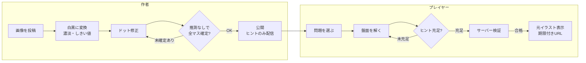
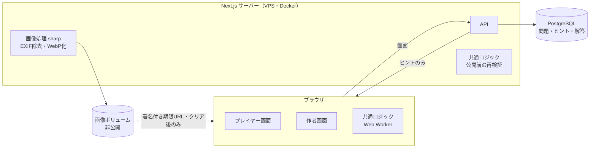

# ピクロス変換ゲーム 設計書

- 版: 0.3（2026-11-10）
- 前提: 作者は運営者（自分）のみ、Next.js 16＋TypeScript構成、段階リリース（MVP → v1 → v2）、ホスティングは既存VPS（Docker＋Traefik）が第一候補
- 関連: `ピクロス変換ゲーム_実装手順書.md`、検証済みコード一式 `picross-starter.zip`
- 0.3の変更: 全体の見直し。ドラッグ操作の仕様を修正（7章）、一覧・問題取得APIの位置づけを整理（10章）、セキュリティヘッダーとCookie属性を追記（12章）、元イラストの扱いを明記（4章）
- 0.2の変更: 試作ソルバーでの検証結果を反映。公開条件を「推測なしで全マス確定」に変更（5章）、画像保存をVPSボリューム＋自前署名URLに（11章）、Next.js 16の仕様に合わせて修正

---

## 1. 概要

カラーイラスト1枚から白黒ピクロス（ノノグラム）を自動生成し、解いた人にだけ元イラストを見せるWebゲーム。作者の作業はアップロードと微調整のみ、問題として成立するかはシステム側で保証。

- **作者**: イラスト投稿、白黒変換の調整、ドット修正、公開
- **プレイヤー**: ブラウザで即プレイ（ログイン不要）、PC・スマホ両対応
- **v1の範囲**: 白黒ピクロス、5×5〜30×30（長方形可）、作者は運営者のみ、Web一般公開
- **範囲外（将来）**: 複数作者の投稿、ランキング、カラーピクロス

---

## 2. 当初案からの補強点

当初案「変換 → 出題 → 正解で元絵表示」に、問題として成立させる仕組みと公開運用の仕組みを追加。最重要は **解の一意性チェック**。

| # | 補強項目 | 当初案で不足していた点 | 補強内容 | 章 |
|---|---|---|---|---|
| 1 | 解の一意性 | 白黒画像は別解を持ちやすい | 「ライン解法＋仮置きで全マス確定（= 推測不要かつ一意）」を公開条件に。未達は公開不可 | 5 |
| 2 | 正解判定 | 判定基準が未定 | 盤面一致でなく全行・全列のヒント充足で判定 | 8 |
| 3 | ネタバレ防止 | 元画像がクリア前に見える経路あり | 元画像はサーバー判定後に期限付きURLで配信 | 8 |
| 4 | 変換の調整 | 自動変換のみ | スライダー調整、線画モード、ドット手修正 | 4・6 |
| 5 | サイズ・縦横比 | 未定 | 5〜30マス、トリミング枠から縦横比を決定 | 4 |
| 6 | 難易度 | 未考慮 | ソルバーの手数から★1〜5を自動付与 | 5 |
| 7 | 操作性 | 未定 | ×印、ドラッグ塗り、Undo/Redo、途中保存 | 7 |
| 8 | スマホ対応 | 未考慮 | 塗り/×モード切替、ピンチズーム、ヒント欄固定 | 7 |
| 9 | 画像のプライバシー | 未考慮 | 再エンコードでEXIF（位置情報など）を除去 | 12 |
| 10 | 権利・通報 | 未考慮 | 権利確認チェック、通報 → 即非公開化 | 12 |
| 11 | 共有 | 未考慮 | 元画像を含まないOGP画像、クリア結果シェア | 8 |
| 12 | 公開後の修正 | 未考慮 | 問題の版管理、途中セーブとの整合 | 6・9 |

---

## 3. 全体フロー



作者側は推測なしで解けることを確認できるまで修正を繰り返し、公開されるのはヒントのみ。プレイヤー側はブラウザとサーバーの二重判定を通った時点で元イラストを受け取る。

---

## 4. 画像 → ピクロス変換仕様

変換は8段のパイプライン。すべてブラウザ上でリアルタイムプレビューし、問題としてサーバーへ保存するのは確定した白黒データと変換パラメータ。クリア時に見せる元イラストは別に、ブラウザで最大辺2048pxへ縮小して送信し、サーバーで再エンコードして保存（12章）。

1. **読み込み**: JPEG / PNG / WebP、10MBまで。EXIFの回転情報を適用、透過部分は白で合成。処理用に最大辺1024pxへ事前縮小
2. **トリミング**: 作者が切り抜き枠を指定。小さいグリッドほど主題を大きく切る必要あり。枠の縦横比 = グリッドの縦横比
3. **グレースケール化**: 輝度 Y = 0.299R + 0.587G + 0.114B
4. **階調調整**: ガンマ → コントラスト → 明るさの順。コントラストは v' = (v − 128) × c + 128
5. **しきい値決定**: 大津法（既定）は調整後の画像全体のヒストグラムから算出。固定しきい値も選択可
6. **縮小**: 指定マス数（幅W × 高さH）へ面積平均で縮小
7. **二値化**: しきい値以下 = 黒マス。白黒反転オプションあり
8. **ノイズ除去**: 8近傍がすべて逆色の孤立マスを反転（任意）

その後、作者がドット単位で手修正（6章）。

- **線画モード（補強）**: 塗りの少ない線画は、面のまま二値化すると縮小時に線が消えやすい。輪郭抽出（Sobel）→ 線の太らせ → 縮小 の別経路を用意し、作者が「面 / 線画」を切替
- **ディザリングは不採用**: 孤立点が大量に出て解きにくく、別解も増えるため

| パラメータ | 範囲 | 既定値 |
|---|---|---|
| 幅・高さ（マス） | 5〜30 | 15×15 |
| モード | 面 / 線画 | 面 |
| ガンマ | 0.5〜2.0 | 1.0 |
| コントラスト | 0.5〜3.0 | 1.5 |
| 明るさ | −100〜+100 | 0 |
| しきい値方式 | 大津法 / 固定 | 大津法 |
| 固定しきい値 | 0〜255 | 128 |
| 白黒反転 | オン / オフ | オフ |
| 孤立点除去 | オン / オフ | オン |

---

## 5. 問題の品質保証

公開条件は「ライン解法と仮置きだけで全マスが確定すること」。どちらも推測を含まない論理手筋なので、全マス確定すれば解は自動的に一つに決まり、プレイヤーも推測なしで解ける。画像から作った白黒データはこの条件を満たさないことがあるため、公開前の検証を必須化。

別解の最小例は2×2の対角配置。下の2つはどちらも行ヒント [1][1]・列ヒント [1][1] で区別不能。

```
■□    □■
□■    ■□
```

| チェック | 方法 | 不合格時 |
|---|---|---|
| 推測不要（= 一意） | ライン解法 → 仮置きで全マス確定するか | 公開不可。未確定マスを赤枠で強調 |
| 別解の有無（参考） | 未確定が残るときだけ分岐探索で解を2個まで探す。3秒で打ち切り | 別解があれば作者の絵との差分マスを強調。時間切れは「不明」 |
| 黒マス率 | 黒マス数 ÷ 全マス数 | 30%未満・70%超で警告 |
| 空行・空列 | ヒントが0の行・列の数 | 全体の3割超で警告 |
| 難易度 | サイズ・解法レベル・仮置き回数 | ★1〜5を自動付与（作者が上書き可） |

### ソルバー方式

1. **ライン解法（レベル1）**: 各行・列で、確定済みマスと矛盾しない全配置の共通部分を確定（動的計画法）。変化がなくなるまで反復
2. **仮置き（レベル2）**: 未確定マスを1つ黒（白）と仮定 → ライン解法 → 矛盾したら逆の色で確定。変化がなくなるまで反復
3. **分岐探索（レベル3、参考情報のみ）**: それでも残れば分岐し、解を2個見つけた時点で「別解あり」として打ち切り

分岐探索は公開判定に使わない。ピクロスの一般解法はNP完全で、試作ではノイズ状の30×30が5秒でも終わらなかったため。

### 試作ソルバーでの検証結果（2026-11-03）

| 盤面 | 結果 |
|---|---|
| イラストに近い画像（ぼかした図形の重ね合わせ）を10〜30マスに変換、60問 | 57問がライン解法だけで全マス確定（各数ms）。残り3問も開示1マスで確定 |
| ランダムノイズ 30×30、黒率30〜45%、20問 | 分岐探索は5秒でも大半が時間切れ → 公開判定から分岐探索を外した根拠 |
| 同じノイズ盤面を開示マスで一意化 | 開示125マス・約14秒。実質「絵を直すべき」ケース |

### 一意化の手段（未確定マスが残った場合、上から順に提示）

1. 未確定マス（赤枠）を見て、作者が1〜数マス手修正
2. **初期開示マス**: 未確定マスを1つずつ自動で開示（最初から塗り済み / ×済みで表示、青枠）し、全マス確定するまで繰り返す。絵を変えずに済む。上限20マス、超える場合は3へ
3. グリッドサイズ・コントラスト・しきい値の変更

---

## 6. 作者向け機能・画面

作者画面は「アップロード → 変換調整 → ドット編集 → 検証 → 公開」の一本道ウィザード。各段階の状態は下書きとして自動保存。

| 画面 | 主な機能 |
|---|---|
| A1 ログイン | 作者専用。v1は運営者のみ（環境変数のパスワード＋署名付きCookie） |
| A2 アップロード | ドラッグ&ドロップ、形式・サイズ検証、トリミング枠指定 |
| A3 変換調整 | 元画像 / グレースケール / ドット結果の3面プレビュー、パラメータスライダー、グリッドサイズ選択 |
| A4 ドット編集 | クリック・ドラッグで白黒反転、Undo/Redo、元画像の半透明重ね表示、ヒント数字のライブ表示 |
| A5 検証 | ソルバー実行（Web Worker）、公開可否・解法レベル・黒マス率・難易度の表示、未確定マス（赤枠）・開示マス（青枠）・別解差分の強調、初期開示マスの自動設定、テストプレイ |
| A6 公開設定 | タイトル、説明、タグ、公開 / 下書き / 非公開、権利確認チェック（必須） |
| A7 作品管理 | 一覧、編集、非公開化、削除、プレイ数・クリア率 |

**公開後の編集（補強）**: 解答を変えると、プレイ途中のセーブデータと食い違う。編集は新しい版として保存し、プレイヤー側で版が合わないセーブは「問題が更新されたため最初から」と案内して破棄。

---

## 7. プレイヤー向け機能・画面

ログイン不要で即プレイ、進捗は端末内に自動保存。クリアの瞬間に白黒ドットが元イラストへ変わる演出が最大の見せ場。

| 画面 | 主な機能 |
|---|---|
| P1 問題一覧 | タイトル・サイズ・難易度のカード。クリア前は元画像なし、クリア後は元イラストのサムネイル。サイズ・難易度・未クリアで絞り込み |
| P2 プレイ | 盤面、行ヒント（左）・列ヒント（上）、タイマー、ツールバー |
| P3 クリア | リビール演出、クリアタイム、シェア、次の問題へ |

| 操作 | PC | スマホ |
|---|---|---|
| 塗る | 左クリック | タップ（塗りモード） |
| ×印 | 右クリック | タップ（×モード） |
| 消す | 同じ状態のマスを再操作 | 同左 |
| 連続入力 | ドラッグ（行または列の直線に固定） | 同左 |
| 取り消し / やり直し | Ctrl+Z / Ctrl+Y | ボタン |
| 拡大縮小 | Ctrl+ホイール | ピンチ |
| キーボード | 矢印で移動、Spaceで塗り、Xで×印 | — |

ドラッグ時は、始点マスに適用した操作（塗り / × / 消し）を、始点と同じ状態だったマスにだけ適用。塗りのドラッグで×を、×のドラッグで塗りを巻き込んで上書きしない。盤面の外でボタンや指を離してもドラッグは終了。

### 補助機能

- 条件を満たした行・列ヒントのグレーアウト
- カーソル行・列のハイライト、5マスごとの太線
- ドラッグ中のマス数表示
- ヒント（1マス開示）: サーバーから1マスだけ受け取る。使用回数はクリア記録に表示
- 答え合わせ（任意）: 間違いマスの「数」だけを返す。回数制限あり
- タイマーの一時停止、途中保存（localStorage、キー = 問題ID＋版）

### クリア演出

黒マスが元イラストの平均色に染まる → モザイクを段階的に細かく → 元イラストへ。2〜3秒、タップでスキップ可。

### スマホ（補強）

30×30は画面幅360pxだと、ヒント欄を除いて1マス10px未満 → ズーム前提。ズーム中もヒント欄は画面端に固定表示。

---

## 8. 正解判定とネタバレ対策

正解は「全行・全列のヒントを満たすか」で判定し、作者の解答との一致は見ない。元イラストはサーバー判定を通過したプレイヤーにだけ配信。

### 判定の流れ

1. クライアント: 盤面が変わるたびにヒント充足をチェック（即時反応）
2. 充足したら盤面をサーバーへ送信（`POST /verify`）
3. サーバー: 同じ判定を再実行 → 合格なら元イラストの期限付き署名URL（10分）とクリアトークンを返す
4. クライアント: クリアトークンをlocalStorageに保存。再訪時はトークンで画像URLを再発行

一意解を保証していれば両方式は同じ結果。ただしヒント充足判定なら、検証漏れや版ずれがあっても正しいプレイを不正解にしない。

| 漏れ経路 | 対策 |
|---|---|
| 問題データ | 解答ビットマップは送らない。送るのはサイズ・ヒント・初期開示マスのみ |
| 元画像のURL | 公開ディレクトリに置かず、HMAC署名付きの期限付きURLでだけ配信。キーは推測不能なUUID |
| 一覧のサムネイル | クリア前は元画像を使わずカード表示 |
| OGP画像 | 空の盤面＋サイズ表記の画像をサーバー生成。元画像は使わない |
| クリア結果のシェア | タイトル・サイズ・タイムのテキスト＋問題ページURLのみ |

**限界**: ヒントがあれば解答は機械的に求まるため、ソルバーを使う不正は防げない。守る対象は「解く前に元イラストを見られること」。ランキング導入時のみ、サーバー側の時間計測など追加対策（v2）。

---

## 9. データモデル

問題本体（`puzzles`）と、解答を持つ版（`puzzle_versions`）を分離。公開後の編集は版を追加し、過去の版も保持。

### puzzles

| 項目 | 型 | 内容 |
|---|---|---|
| id | uuid | 公開URLにも使用 |
| author_id | uuid | 作者 |
| title / description | text | プレーンテキスト |
| status | enum | draft / published / hidden |
| current_version | int | 現在の版番号 |
| tags | text[] | 絞り込み用 |
| play_count / clear_count | int | 集計値 |
| created_at / published_at | timestamptz | |

### puzzle_versions

| 項目 | 型 | 内容 |
|---|---|---|
| puzzle_id + version | uuid + int | 複合主キー |
| width / height | int | 5〜30 |
| solution | text | 解答。行優先ビット列のbase64（30×30で152文字） |
| row_clues / col_clues | jsonb | 例: `[[3,1],[2],[]]`（空配列 = 0） |
| given_cells | jsonb | 初期開示マス `[{x, y, state}]` |
| difficulty | int | 1〜5 |
| black_ratio | real | 黒マス率 |
| solver_result | jsonb | 一意性・解法レベル・手数 |
| convert_params | jsonb | 変換パラメータ（再編集用） |
| image_key | text | 表示用元イラストの保存キー |
| created_at | timestamptz | |

### その他

| テーブル | 主な項目 |
|---|---|
| users | id, display_name, email, role（admin / author） |
| reports | id, puzzle_id, reason, detail, status, created_at |
| clear_records（v2） | id, puzzle_id, version, player_id（匿名）, time_ms, hints_used |

---

## 10. API設計

プレイヤー向けAPIは解答と元画像を返さないのが原則。元画像のURLを返すのは判定合格時（`/verify`）とクリアトークン提示時（`/reveal`）だけ。

| メソッド | パス | 用途 | 認証 |
|---|---|---|---|
| GET | /api/puzzles | 公開中の問題一覧（タイトル・サイズ・難易度）。任意 ※ | 不要 |
| GET | /api/puzzles/{id} | 問題データ（版・サイズ・ヒント・初期開示マス）。任意 ※ | 不要 |
| POST | /api/puzzles/{id}/verify | 盤面を判定。合格時に画像URL＋クリアトークン | 不要（レート制限） |
| POST | /api/puzzles/{id}/reveal | クリアトークンで画像URLを再発行 | クリアトークン |
| POST | /api/puzzles/{id}/hint | 1マス開示 | 不要（回数制限） |
| POST | /api/puzzles/{id}/check | 間違いマスの数を返す | 不要（回数制限） |
| POST | /api/puzzles/{id}/report | 通報 | 不要（レート制限） |
| GET | /api/images/{key}?exp=…&sig=… | 元イラストの配信。期限内・署名一致のときだけ返す | 署名付きURL |
| GET | /play/{id}/opengraph-image | OGP画像（空盤面＋サイズ） | 不要 |
| POST | /api/author/login | パスワード確認 → 署名付きCookie発行 | 不要（試行回数制限） |
| POST | /api/author/images | 画像受付 → 再エンコード → 保存、画像キーを返す | 作者 |
| POST | /api/author/puzzles | 問題作成（解答・パラメータ・タイトル） | 作者 |
| PUT | /api/author/puzzles/{id} | 更新（新しい版を作成） | 作者 |
| POST | /api/author/puzzles/{id}/publish | サーバーでヒント再計算・一意性再検証 → 公開 | 作者 |

※ 一覧・プレイ画面はサーバー側で直接DBから取得して描画するため、この2つのAPIは画面には不要。外部から問題データを使う必要が出たときに追加。

```json
// POST /api/puzzles/{id}/verify
{ "version": 3, "board": "<行優先ビット列のbase64>" }

// 合格
{ "ok": true, "imageUrl": "/api/images/<key>?exp=...&sig=...（10分有効）", "clearToken": "..." }
// 不合格
{ "ok": false }
```

- クリアトークン: HMAC署名付き（問題ID・版・発行時刻）。DB不要で検証可
- 署名鍵はクリアトークン・画像URL・作者セッションで別々にする（1つ漏れても他に波及しない）
- 問題作成・公開時はクライアントの検証結果を信用せず、サーバーで解答からヒントを作り直して同じソルバーを再実行
- 版ずれ（プレイ中に問題が更新された）は 409 を返し、プレイ画面で「問題が更新されたため最初から」と案内

---

## 11. システム構成・技術スタック

推奨はTypeScriptで統一したNext.js構成。変換・ヒント生成・ソルバー・判定を1つのライブラリにまとめ、ブラウザ（プレビュー）とサーバー（再検証）で同じコードを使えるのが最大の利点。



| 層 | 推奨 | 理由 |
|---|---|---|
| フロント | Next.js 16（App Router）＋TypeScript | 一覧・プレイ画面のSSR / OGPと作者画面を1つに。問題データは `"use cache"` でキャッシュし、公開・非公開化で破棄 |
| 盤面描画 | SVG（またはDOM） | 最大900マスなら十分高速、クリック判定とアクセシビリティが容易 |
| 画像処理（ブラウザ） | Canvas API＋Web Worker | プレビューを即時更新、UIを止めない |
| 共通ロジック | packages/core（純TypeScript） | 変換・ヒント生成・ソルバー・判定。単体テスト対象 |
| 画像処理（サーバー） | sharp | 再エンコード・EXIF除去・WebP化・OGP生成 |
| DB | PostgreSQL＋Drizzle ORM | jsonbでヒント・パラメータを柔軟に保存 |
| 画像保存 | VPSのDockerボリューム＋自前のHMAC署名付き期限URL | 外部サービス不要。S3互換（Cloudflare R2など）へは保存処理1ファイルの差し替えで移行可 |
| 作者認証 | 環境変数パスワード＋HMAC署名Cookie、`proxy.ts` で保護 | v1は運営者のみ。複数作者化（v2）でAuth.js等へ |
| レート制限 | Traefik の RateLimit ミドルウェア | アプリ側に状態を持たずに済む |
| ホスティング | 既存VPS（Docker＋Traefik）を第一候補 | 追加費用なし。Vercelにする場合は画像をR2へ |

- **MVPはDBなし**: 作者画面が問題JSON（ヒント＋解答）を書き出し、`data/puzzles/` に置いてプレイ画面が読み込む。ネタバレ対策（画像の署名URL）はv1から
- **アップロード**: ブラウザで最大辺2048pxに縮小してから送信（サーバーレスのリクエストサイズ上限対策、通信量削減）

### 代替案: Django＋PostgreSQL（既存VPS）

- 利点: 管理画面をDjango Adminで即用意、慣れた構成で運用可
- 欠点: ソルバーがTypeScript（ブラウザ）とPython（サーバー）の二重実装
- 回避策: サーバー側はヒント充足判定（数十行で済む）だけPythonで持ち、一意性の再検証はNodeのサイドカーコンテナで同じTSコードを実行

---

## 12. セキュリティ・権利・運用

アップロード画像は必ずサーバーで再エンコードし、元ファイルは保存しない。位置情報の漏えいと不正ファイルを同時に防ぐため。

| 項目 | 対策 |
|---|---|
| 位置情報など | 再エンコードでEXIF・メタデータを全削除。元ファイルは破棄 |
| 不正ファイル | 拡張子でなく中身で形式判定、デコード不可は拒否、入力ピクセル数の上限（巨大画像による負荷対策） |
| 作者認証 | v1は運営者のみ。12文字以上のパスワード、HttpOnly・Secure・SameSite=Strict のCookie、ログイン試行回数制限（Traefik） |
| 乱用 | verify / hint / check / report にIP単位のレート制限（Traefik） |
| XSS | タイトル・説明はプレーンテキストで描画 |
| ヘッダー | 全ページに X-Frame-Options: DENY（他サイトへの埋め込み禁止）、X-Content-Type-Options: nosniff、Referrer-Policy: strict-origin-when-cross-origin |
| 入力検証 | URLや本文から来たID・サイズ・盤面データは、DBや計算に渡す前に形式と範囲を確認 |
| 権利 | 投稿時に「自作、または公開の許諾あり」のチェック必須。利用規約・ガイドラインを掲載 |
| 二次創作 | 受け入れ可否と条件を規約に明記（15章） |
| 不適切画像 | 通報 → 管理画面からワンクリック非公開化。複数作者化（v2）では事前審査を追加 |
| バックアップ | DBは日次、ストレージはバージョニング |
| 監視 | エラー監視、アクセス解析はCookie最小限 |
| プレイヤー情報 | 匿名ID（端末内）のみ。プライバシーポリシー掲載 |

---

## 13. 非機能要件

個人運営前提。速度と端末対応を優先し、可用性はベストエフォート。

| 項目 | 目標 |
|---|---|
| 対応ブラウザ | Chrome / Edge / Safari / Firefox の最新版、iOS Safari、Android Chrome |
| 最小画面幅 | 360px（20×20超はズーム前提） |
| 変換プレビュー | パラメータ変更から0.3秒以内に更新 |
| 公開判定（ライン解法＋仮置き） | イラスト由来の30×30で1秒以内（試作で数ms） |
| 別解探索（参考情報） | 3秒で打ち切り |
| プレイ画面表示 | モバイル回線でLCP 2.5秒以内 |
| 表示用イラスト | WebP、最大辺1600px |
| アクセシビリティ | キーボードのみでプレイ可能、色だけで状態を区別しない（×は形で表示）、ダークモード |
| 多言語 | v1は日本語。文言は外部ファイル化して後から追加可能に |
| 可用性 | ベストエフォート |

---

## 14. 段階リリース計画

まず自分用のMVPで変換と検証の品質を固め、一般公開はその後。複数作者の受け入れは運用体制が整ってから。

| 段階 | 目的 | 主な実装 | 次へ進む条件 |
|---|---|---|---|
| MVP | 自分で作って遊べる（ローカル） | 変換・ドット修正・ソルバー検証・PCプレイ・クリア演出。問題はJSONファイル（DBなし） | 公開予定の問題がすべて検証を通過 |
| v1 | 一般公開 | DB・API・画像ストレージ、判定API・期限付きURL、スマホ操作、途中保存、OGP、通報、作者ログイン | 通報・削除の運用が回る |
| v2 | 拡張 | 複数作者の投稿、クリア記録・ランキング、シリーズ問題、カラーピクロス | — |

---

## 15. 未決事項

- [ ] 作者は自分のみか、一般ユーザーの投稿も受けるか（本書はv1 = 自分のみで設計）
- [ ] 推測が必要な問題（レベル3）を公開可とするか（推奨: 不可。開示マスで一意化）
- [ ] ホスティング: 既存VPS（推奨、追加費用なし）か Vercel＋R2 か
- [ ] クリア記録・ランキングの要否（要ならログインとタイム計測の設計を追加）
- [ ] 二次創作（ファンアート）の受け入れ可否
- [ ] 広告などの収益化の有無（規約・プライバシーポリシーに影響）
- [ ] サービス名・ドメイン
- [ ] 公開済み問題の編集を許すか（許さないなら版管理を簡略化可）